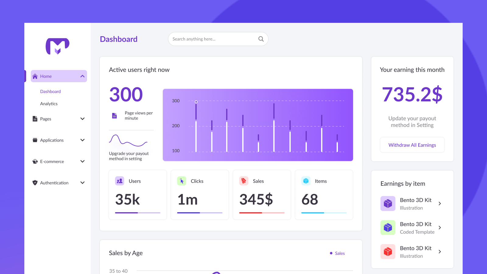
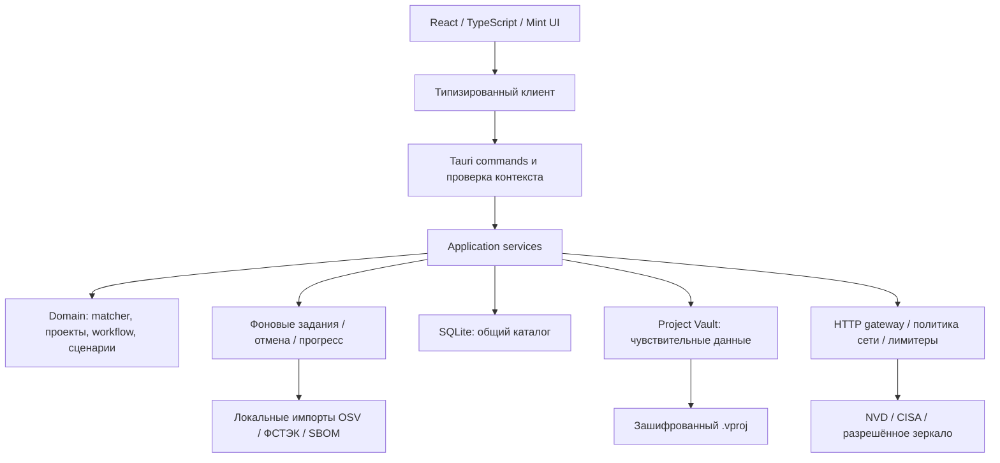

# VulnPulse
## План новой desktop-версии · Tauri 2 / Rust / TypeScript

**Дата:** 17 ноября 2026. **Состояние:** в работе этап 0. **Первая целевая платформа:** Windows x64. macOS и Linux проходят собственную приёмку позднее.

> Локальное рабочее место специалиста по безопасности: от состава ПО и архитектуры — к объяснимым обнаружениям, приоритетам и действиям. Проекты открываются без аккаунта и без интернета.

Переход на Tauri запрошен пользователем. Это новая реализация: **React + TypeScript в системном WebView, Rust в нативном ядре**. Electron, preload, Node runtime и Drizzle в новую поставку не входят. Tauri использует WebView ОС; размер, скорость и потребление памяти новой версии предстоит измерить. [Архитектура Tauri](https://v2.tauri.app/concept/architecture/).

Правила разработки — [AGENTS.md](AGENTS.md), фактическое состояние — [PROJECT_MEMORY.md](PROJECT_MEMORY.md), сохранённые материалы — [references/README.md](references/README.md).

## 1. Что сохраняем из старого проекта

| Основа | Что берём | Что улучшаем в новой версии |
| --- | --- | --- |
| Mint из Figma | Палитра, спокойные карточки, боковое меню, плотные таблицы, локальные изображения и атрибуция | Единые компоненты, общий набор состояний, проектная навигация и топология |
| Каталог | NVD, CISA KEV, локальный OSV, ФСТЭК XML/GZ, фильтры, подробная карточка | Разделение канонической уязвимости и ревизий источников; прозрачные конфликты и свежесть |
| Импорт и сеть | Ограничения, отмена, backoff, нормализация, транзакционность | Централизованный режим «Без сети», фоновые задачи Rust и отзывчивый UI |
| Matcher | CPE/PURL, проверенные границы версий, консервативный `unknown`, большой корпус тестов | Чистое Rust-ядро, сохранение оценок, доказательства и автоматический пересчёт |
| Workflow | Статусы, заметки, SLA, ревизии, формы с сохранением черновика | Независимая обработка каждой установки вместо глобального статуса CVE |
| Обзор | KPI, Recharts, переход к отфильтрованному списку, состояние источников | Проектные метрики и дельта анализов; отдельный учёт неизвестности |
| RBVM-концепция | Проекты, топология, сценарии угроз, бизнес-профили, What-If | Поэтапная реализация с объяснимой методикой и проверкой предпосылок |
| Проверки | Регрессионные сценарии, синтетические данные, UI-скриншоты, проверки миграций | Контрактные тесты Rust↔TS, настоящий Tauri E2E и проверка установщика |

**Реально существовали:** каталог, импорт источников, scheduler, пять экранов, отдельный matcher и глобальный workflow. **Оставались проектами:** Vault, модель установок/findings, сохранённые оценки, граф, сценарии и What-If. Исторические 895 unit-тестов и 24 E2E относятся к Electron и не являются проверкой нового приложения.

Исходный снимок: `c44d73605985dff7b9c8fadc929a06efa3c6c068`, локальная ветка `develop`. В него входит исправление подготовки Electron перед CI-тестами; отправка этого коммита была прервана, успешный CI не подтверждён. Сохранённый Git bundle включает историю и этот коммит. Детали восстановления и ограничения — в [паспорте материалов](references/README.md).

## 2. Продукт и границы первой версии

Основной пользователь — AppSec/SOC, DevOps или специалист ЗИ, которому нужно понять: **где стоит затронутое ПО, почему оно считается затронутым, кто исправляет и что изменилось после анализа**.

Путь пользователя:

1. **Welcome Hub:** создать/открыть `.vproj`, посмотреть недавние проекты и актуальность каталога.
2. **Настроить проект:** добавить активы и ПО, затем зоны, связи и бизнес-процессы по мере необходимости. Позволить начать с одного сервера без обязательного рисования графа.
3. **Импортировать сведения:** локальные файлы или явно разрешённое обновление общего каталога.
4. **Запустить анализ:** увидеть этапы, полноту, новые и изменившиеся findings.
5. **Работать с результатом:** доказательства → решение → ответственный → срок → история.
6. **Сохранить и перенести:** защищённый файл, резервная версия, восстановление на другой машине.

**MVP для пилота:** каталог и источники, Vault, проекты/активы/установки, минимальная топология, matcher с persistence, findings/заметки/SLA, снимки/дельта, Dashboard и рабочая Windows-поставка. Это этапы 0–7.

**Развитие после MVP:** объяснимые архитектурные сценарии, бизнес-оценка, What-If, расширенные отчёты, Compose/Terraform и опциональные интеграции.

Активное сканирование сети, эксплуатация уязвимостей, обязательная авторизация, облачная отправка проектов, совместное редактирование и маркетплейс плагинов не входят в первую версию. Тарифы, лимиты узлов, ГОСТ-профиль и сертификация остаются отдельными продуктовыми решениями.

## 3. Визуальное направление — Mint для аналитической работы



Референс: [Free Admin Dashboard UI Kit / Mint](https://www.figma.com/community/file/1244293267600418871/free-admin-dashboard-ui-kit), автор [Ali / @malik_ali](https://www.figma.com/@malik_ali). В старом исследовании от 2026-11-05 зафиксирована [CC BY 4.0](https://creativecommons.org/licenses/by/4.0/); атрибуцию сохранить в документации и разделе «О дизайне». Это сведения сохранённого исследования, а не новая проверка лицензии Figma.

Изучены публичные превью; внутренние слои, variables, точный шрифт и все состояния Figma не извлечены. Новые экраны ниже — адаптация VulnPulse. Логотип Mint и финансовые данные превью не являются частью продукта.

### Токены и композиция

| Роль | Значение / правило |
| --- | --- |
| Фон | `#F4F5F9` |
| Панели, sidebar, таблицы | `#FFFFFF` |
| Основной акцент / focus | `#6E39CB` |
| Мягкий акцент | `#DECCFE` |
| Основной текст | `#3A3541` |
| Вторичный текст | `#6C6575` |
| Границы | `#E6E2EC`; границы полей `#C6BECE` |
| Ошибка | `#A82443` + текст и значок |
| Шрифт | Локальный Segoe UI/system-ui; Inter с кириллицей — только локальный файл с лицензией |
| Размеры | Текст 13–14 px; заголовок экрана 22–24; карточки 15–16; KPI 28–36 |
| Геометрия | Sidebar около 222 px; шаг отступов 4/8/12/16/24; радиус панелей 8 px; строки 36–40 px |
| Поверхности | Тонкая граница, слабая тень; акцент обозначает действие и выбор |

Первые пять цветов основаны на сохранённом превью; дополнительные токены — из реализации старого UI. Полный CSS сохранён как [справочный материал](references/design/legacy-main.css), а не готовый stylesheet нового приложения. Контраст и поведение в WebView проверить заново. Из мелких подписей старого UI не переносить нечитаемый текст 9–11 px в основные элементы управления.

Severity: отдельные цвета Critical/High/Medium/Low/None; неизвестная severity — отдельное состояние. KEV, ручной статус и применимость — разные badges. Цвет всегда сопровождается текстом. В графиках палитра едина с таблицами; график имеет доступное текстовое представление.

### Рабочее пространство

```text
┌──────────────────┬────────────────────────────────────────────────────────┐
│ VulnPulse        │ Проект / раздел        Поиск          Анализ · Сохранить│
│ Выбор проекта    ├────────────────────────────────────────────────────────┤
│                  │ Актуальность каталога · Последний анализ · Изменения  │
│ Обзор            ├──────────────────────────────────┬─────────────────────┤
│ Обнаружения      │ Фильтры / KPI / инструменты      │ Детали выбранного   │
│ Активы и ПО      │                                  │ объекта             │
│ Архитектура      │ Таблица или граф                 │                     │
│ Анализы          │                                  │ Доказательства      │
│                  │                                  │ История · SLA       │
│ Каталог          │                                  │ Действия            │
│ Источники        ├──────────────────────────────────┴─────────────────────┤
│ Настройки        │ Фоновая задача · этап · счётчики · отмена              │
└──────────────────┴────────────────────────────────────────────────────────┘
```

Детали открываются в боковой панели без потери фильтра, страницы и выделения. На узком окне панель становится полноширинным диалогом. Недоступные будущие разделы не выдаются за работающие функции.

| Экран | Содержимое и основной сценарий |
| --- | --- |
| Welcome Hub | Создание/открытие, недавние файлы с настройкой приватности, восстановление, состояние каталога |
| Обзор | Affected/unknown, KEV, новые findings, просрочки; KPI ведёт к точной выборке |
| Обнаружения | Фильтры проекта/актива/ПО/severity/KEV/применимости/статуса/ответственного; массовые действия с предварительным просмотром |
| Деталь finding | Установка и версия, доказательства и причины unknown, источники, ручной статус, заметки, SLA, история |
| Активы и ПО | Таблица активов, вложенный инвентарь, CRUD, импорт/конфликты, архивирование |
| Архитектура | Палитра узлов, зоны, направленные связи, inspector; таблица связей доступна без работы мышью |
| Анализы | Полнота, версия входов, длительность, изменения относительно выбранного полного снимка |
| Каталог | Общие карточки и источники, не смешанные с workflow отдельных проектов |
| Источники | Локальный импорт, разрешённые обновления, свежесть, ошибки и история заданий |
| Настройки | Режим сети, расписания, NVD key write-only, блокировка, резервные версии, внешний вид и атрибуция |

Базовая светлая тема обязательна; тёмная тема — отдельная работа после приёмки светлой. Сохранённые сравнения: [каталог](references/screenshots/catalog-1280.png), [обзор](references/screenshots/dashboard-1280.png), [инвентарь](references/screenshots/stack-1280.png), [workflow](references/screenshots/workflow-1280.png), [каталог при 150%](references/screenshots/catalog-150-percent.png).

### Критерии визуальной готовности

- Реальные скриншоты в WebView: 1280×800 при 100/125/150%, дополнительно 1024×768; длинные русские названия, большие числа и пустые значения.
- Tab/Shift+Tab, Enter, Escape с возвратом фокуса, Ctrl+F в контексте раздела; горячие клавиши не мешают вводу. Диалог удерживает фокус, форма имеет доступные подписи и сообщения об ошибке.
- Загрузка, пустая база и пустой результат фильтра различаются. Ошибка сохранения сохраняет черновик. Конфликт ревизии предлагает повторное чтение/сравнение.
- Скелетон не выдаётся за данные, пример не выдаётся за анализ, прогресс строится по реальным этапам. Неизвестный общий объём показывается без выдуманного процента.
- Для больших таблиц — серверная пагинация и стабильная сортировка; виртуализация по результатам измерений. Фильтры сохраняются при переходах, все рабочие действия доступны с клавиатуры.

## 4. Целевая архитектура



### Стек и назначение

| Слой | Базовое направление плана | Условие внедрения |
| --- | --- | --- |
| Desktop | Tauri 2, Rust stable, системный WebView | Зафиксировать совместимые версии и проверить Windows-сборку |
| UI | React, TypeScript strict, Vite, Tailwind, shadcn/ui, Lucide, Recharts, Zustand | Переносить внешний вид и сценарии; адаптировать API |
| Граф | React Flow как предпочтительный кандидат | Прототип зон, портов, выделения и 100/500 узлов; лицензия и доступность |
| Domain | Rust + независимые модули и тесты | Логика тестируется без Tauri и SQLite |
| DTO | Serde; генерация TS через совместимый инструмент, кандидаты Specta/ts-rs | Проверить tagged enums, ошибки, nullable, даты и границы чисел |
| Storage | SQLite через rusqlite; отдельный исполнитель запросов | Миграции, FTS/индексы по измерениям; SQL не доступен JS |
| Async/HTTP | Tokio + reqwest как кандидаты | Централизованный gateway, лимиты и тестируемый transport |
| Парсинг | Serde JSON; потоковый XML-парсер, кандидат quick-xml | Фикстуры, лимиты и отказ от опасных конструкций |
| Vault | Проверенные Rust KDF/AEAD-библиотеки, Argon2id + AES-256-GCM как кандидаты | Тестовые векторы, измерения и отдельное решение о формате |
| Диагностика | Структурированные ошибки, коды и локальные обезличенные логи | Без секретов, содержимого проектов и сырого HTTP-payload |
| Проверки | Vitest/Testing Library, Rust unit/integration, coverage, desktop WebDriver | Настоящий runtime отдельно от браузерных mocks |

Это выбор направления разработки, не список уже установленных пакетов. Точные версии и совместимость фиксируются на этапе 0. Отдельные SQLCipher, Stronghold или второй SQLite-драйвер не добавлять без необходимости: сначала проверить один выбранный путь хранения. Новая криптобиблиотека не наследует проверку старого hash-wasm.

### Структура будущих исходников

```text
src/
  app/                         маршруты, оболочка, провайдеры
  features/                    welcome, catalog, projects, findings, topology…
  components/ui/               визуальные примитивы
  lib/api/                     единственный адаптер Tauri и обработка ошибок
  generated/                   DTO, команды и события из Rust
  styles/                      семантические токены и общие стили
src-tauri/
  capabilities/                минимальные права для конкретных окон
  permissions/                 права custom commands
  migrations/catalog/          версия и checksum каждой SQL-миграции
  migrations/project/          отдельная схема проектного хранилища
  src/
    commands/                  IPC-граница, без бизнес-логики
    contracts/                 DTO, ошибки, события
    domain/                    projects, matcher, workflow, risk
    application/               сценарии, транзакции, задания
    infrastructure/            db, feeds, http, vault, imports
  tests/                       интеграции и аварийные сценарии
tests/fixtures/                синтетический общий корпус Rust/TS
tests/desktop/                 реальные desktop-сценарии
docs/decisions/                принятые решения с причинами и ограничениями
references/                    референсы и архив; не включать в runtime-бандл
```

Расположение — целевое. На этапе 0 один Rust crate с отдельными модулями для IPC, контрактов, сервисов, домена и SQLite. Интерфейсы выделять у реальных границ I/O. Общую БД каталога и проектную сессию не удерживать под одним глобальным lock во время сети или KDF.

### Контракты и задания

Каждая команда принимает ограниченный запрос и возвращает DTO либо ошибку с устойчивым кодом, безопасным сообщением и возможностью повтора. Даты — UTC с явным форматом; большие идентификаторы — строки. Запись содержит ожидаемую ревизию для обнаружения конфликтов.

Проектная команда проверяет не только переданный ID, но и текущую разблокированную сессию. Задание связано с проектом, сессией и ревизиями входов. Закрытие/блокировка отзывает сессию и прекращает публикацию чувствительных событий. События — уведомления; состояние доступно отдельным запросом для восстановления после пропуска.

Набор команд постепенно покрывает `catalog`, `sources`, `projects`, `assets`, `installations`, `analysis`, `findings`, `workflow`, `vault`, `settings`. Фронтенд не получает `executeSql`, произвольный `fetchUrl` или общее выполнение shell.

В Tauri зарегистрированные пользовательские команды по умолчанию доступны всем окнам/webviews; ограничить их через механизм AppManifest/permissions и capabilities и проверить отрицательными тестами. Разрешения нескольких capabilities суммируются. [Документация capabilities](https://v2.tauri.app/security/capabilities/).

## 5. Предметная модель

| Сущность | Идентичность и смысл |
| --- | --- |
| SourceRecord / Revision | Источник + его собственный ID; исходные сведения, время, hash и происхождение |
| Vulnerability | Каноническая карточка с явными alias-связями; конфликты и история слияний не теряются |
| Project | Изолированный контекст инфраструктуры, анализа и бизнес-параметров |
| Asset / Zone / Flow | Узел, граница доверия и направленная связь с известными портами/протоколами |
| SoftwareInstallation | Устойчивая установка на одном активе; CPE/PURL, версия, источник и история изменений |
| Finding | Отслеживаемая проблема для проекта, установки и уязвимости; отдельный workflow |
| Assessment | Результат проверки в снимке: применимость, причина, evidence и версия правила |
| AnalysisSnapshot | Неизменяемый результат с ревизиями входов, временем, полнотой и предупреждениями |
| Note / SLA / WorkflowEvent | Авторство/ответственный, срок, решение и история изменения конкретного finding |
| BusinessProcess | Зависимости от активов, критичность, RTO, данные и введённые пользователем параметры ущерба |
| ThreatScenario / WhatIfBranch | Предпосылки сценария и отдельная версия изменений относительно базового анализа |

Три правила пользователя закреплены в [AGENTS.md](AGENTS.md). Остальные структуры — целевой дизайн новой реализации. До изменения схемы фиксировать ключи, уникальности и политику архивирования в ADR. Изменение названия актива не меняет его ID. Изменение версии помечает старую оценку устаревшей, сохраняя workflow.

Снимок хранит версии графа, инвентаря, каталога, matcher/правил и бизнес-параметров. При обновлении каталога во время анализа обеспечить согласованное чтение; результат старой ревизии допустим с явной пометкой. Не переписывать доказательства завершённого анализа сегодняшними данными.

Дельта различает: новую публикацию, новое finding на установке, изменение применимости, новые evidence, изменение приоритета и ручное действие. `Patched` — решение workflow, а не автоматический перевод при отсутствии совпадения. Частичный/отменённый анализ не заменяет полный baseline.

## 6. Хранение, приватность и перенос

### Каталог и проект

Общий публичный каталог — SQLite на диске. Проектная топология, ПО, workflow и бизнес-параметры — в Vault. Первый кандидат реализации Vault: отдельная in-memory SQLite и зашифрованный версионированный `.vproj` на диске. До принятия формата проверить сериализацию, ограничения размера и пиковую память на целевых проектах. Если этот путь не проходит измерения, выбрать другую схему хранения отдельным решением до записи реальных проектов.

В открытом виде не писать проектные WAL, временные таблицы, staging, autosave или отчёты без явного экспорта. Публичные фиды могут иметь ограниченный дисковый staging. Недавние файлы раскрывают путь/имя: дать настройку отключения и очистки; имена не включать в открытый заголовок контейнера.

### Контракт Vault

До реализации определить версию формата, структуру аутентифицируемого заголовка, KDF/AEAD, границы памяти/времени, соль/nonce, совместимость и обновление формата. Парсер проверяет размер и параметры **до** дорогостоящего KDF. Уникальность nonce под одним ключом обязательна. KDF работает в ограниченном исполнителе.

Сохранение: согласованный снимок → шифрование → временный ciphertext в том же каталоге → синхронизация и проверенная замена → восстановимая предыдущая версия. Проверить отказ на каждой границе записи и замену на Windows. Гарантии сетевых/FAT-носителей описать отдельно. Внешнее изменение файла или второй процесс вызывают конфликт, а не молчаливую перезапись.

Открытие: проверка контейнера → KDF → аутентификация → десериализация/валидация → миграция в памяти → новая сессия. Неверный пароль, повреждение, неподдержанный формат и исчерпание ресурсов обрабатываются без вывода секретов. Автоблокировка учитывает несохранённые изменения и завершает чувствительные задания.

Граница защиты — закрытый файл и контролируемые записи приложения. Swap, дампы ОС, открытый процесс и компрометация компьютера не устраняются переходом на Rust. Независимое ревью необходимо до production-заявления о защищённости. Ключ NVD хранится отдельно средствами ОС/проверенного защищённого хранилища и не является паролем проекта.

### Совместимость и завершение старого проекта

1. Сохранить исходники и историю, дизайн, лицензии и тестовые сценарии. **Выполнено для отслеживаемых Git-файлов:** [bundle и материалы](references/README.md). Это ещё не перенос пользовательских данных.
2. Перед окончательным удалением составить перечень локальных баз, настроек, неотправленных коммитов и неотслеживаемых файлов. Создать согласованные резервные копии SQLite с учётом WAL; реальные секреты не помещать в репозиторий.
3. Новый importer читает копию старой базы в режиме read-only, проверяет версию, показывает dry-run и конфликты. Старую базу не мигрировать на месте.
4. Пользователь выбирает актив для каждой переносимой установки. Глобальные заметки, SLA и статусы сохраняются в legacy-разделе выбранного защищённого проекта; заметки/SLA назначаются findings отдельным действием с происхождением. Статусы не размножаются автоматически.
5. Проверить повторный импорт без дублей, историю, количества, связи, повторное открытие `.vproj`, восстановление и понятный отчёт о неперенесённых данных. Библиотеки и старую историю можно восстановить из bundle, пользовательскую БД — только из её отдельной копии.
6. Удаление старой рабочей папки — заключительный шаг перехода после проверки резервных копий и принятия новой версии. Текущий запрос выполняется как подготовка нового проекта; старый каталог пока сохранён. GitHub-репозиторий и пользовательские базы этим планом не удаляются.

## 7. Этапы разработки

Этап 0 в работе. Демонстрационный каталог, Windows-сборка и проверка IPC выполнены локально. Этапы 1–10 ожидают начала. Зависимости: `0 → 1 → 2 → 3 → 4 → 5 → 6 → 7 (пилот) → 8 → 9 → 10`. Порядок можно уточнить по измерениям, сохраняя границы данных и приёмку.

### Этап 0 · Воспроизводимая основа

**Результат:** новое приложение запускается и собирается в CI, правила границ проверяются автоматически.

- Создать отдельный Git-репозиторий с `main`/`develop`; выбрать remote без перезаписи старой истории. Scaffold Tauri 2 + React/TS/Vite; закрепить npm/Rust toolchain и lockfiles.
- Проверить Windows toolchain, WebView2 и сборку установочного артефакта. Решить поставку WebView2 для офлайн-машин. Окружение сверять с [официальными prerequisites](https://v2.tauri.app/start/prerequisites/).
- Поднять domain/application/infrastructure/commands, DTO-генерацию, формат ошибок и один реальный запрос UI→Rust→SQLite на синтетических данных.
- Настроить CSP, capabilities/custom permissions, временные тестовые профили, fmt/clippy/typecheck/tests/coverage/build и проверку документации.
- Добавить CI smoke настоящего приложения. Драйверы, инструменты и fixture runtime готовить отдельным setup-шагом до параллельных тестов. Не переносить Electron/Argon2 evaluation-tests в новый runtime.

**Готово, когда:** чистый checkout воспроизводимо собирается; window smoke и IPC проходят; недопустимый вызов отклоняется; DTO regeneration не даёт diff; первый Windows-артефакт запускается без Node/Electron; нет скрытых сетевых запросов приложения.

### Этап 1 · Дизайн-система и рабочий каталог

**Результат:** оболочка Mint и полноценный экран каталога на локальных синтетических данных.

- Токены, typography, Button/Input/Select/Dialog/Drawer/Table/Badge/Toast, панель фильтров и состояний.
- Sidebar, заголовок, поиск, фильтры, пагинация, стабильная сортировка, деталь уязвимости и доступность.
- Первая схема catalog/source records и миграции, запросы и агрегаты в Rust; нормализованные DTO.
- Атрибуция Mint/shadcn и сохранённые скриншоты в тестах. Welcome Hub пока открывает явно обозначенный demo, без имитации защищённого сохранения.

**Готово, когда:** запрос → SQLite → таблица работает в desktop; пустая база/фильтр/ошибка различаются; длинные тексты и масштаб 150% не ломают действия; клавиатурный сценарий проходит; UI не импортирует инфраструктуру.

### Этап 2 · Источники, сеть и импорт

**Результат:** реальные данные поступают в каталог контролируемо, с происхождением и отменой.

- Единый HTTP gateway, общий NVD limiter, политика «Без сети», настройки и сохранённые расписания; по умолчанию автообновления выключены.
- NVD/CISA сетевые адаптеры, OSV JSON локально, ФСТЭК XML/GZ локально; зеркало отдельным явным действием.
- Нормализация и дедупликация, ревизии источников, incremental cursor/ETag, последний полный успех и история заданий.
- Staging, проверка формата/лимитов и транзакционная публикация. Cursor обновляется только вместе с применёнными данными. Отмена до commit сохраняет прежнюю ревизию; финальную фазу commit обозначить как неотменяемую.

**Готово, когда:** fixture-контракты всех четырёх источников проходят; 429/timeout/битые данные/повтор/отмена не портят каталог; отключённая сеть блокирует ручной запрос и scheduler; ключ/инвентарь не попадают в запросы и логи; большой импорт не блокирует UI. Сетевой smoke выполняется отдельно от детерминированных unit-тестов.

### Этап 3 · Проектная модель и Vault

**Результат:** минимальный проект с одним активом/установкой создаётся, безопасно сохраняется, открывается и восстанавливается.

- Зафиксировать ключи сущностей, ревизии, архивирование и формат ошибок конфликтов. Разделить публичный каталог и проектную сессию.
- Прототип KDF/AEAD/SQLite snapshot в собранном Rust/Tauri-приложении; измерить время и память, принять ADR формата `.vproj`.
- Реализовать создание, открыть/сохранить/сохранить как, смену пароля, блокировку, recovery, конфликт внешнего изменения и версионированные миграции.
- Welcome Hub, форма пароля, недавние файлы с настройкой приватности и предупреждение о несохранённом состоянии.
- Тестовые векторы, fuzz заголовка, повреждение/обрезание, крайние параметры KDF, отказ записи, аварийное завершение и повторное открытие.

**Готово, когда:** перенос файла на вторую тестовую среду работает без аккаунта; ошибочный пароль и повреждение отклоняются; прежняя версия восстанавливается после каждого смоделированного сбоя; приложение не создаёт plaintext проекта; блокировка отзывает сессию и очищает UI. До независимого ревью — статус экспериментального Vault и только синтетические пилотные данные.

### Этап 4 · Активы, инвентарь и архитектура

**Результат:** пользователь описывает инфраструктуру таблицей и графом, сохраняя её в Vault.

- CRUD активов, установок, зон, портов и направленных потоков; undo/redo для графа, inspector, поиск и связь таблица↔граф.
- Импорт конфигурации и SBOM: начать с фиксированного подмножества CycloneDX JSON, затем SPDX по отдельным фикстурам. Показывать неподдержанные поля и происхождение.
- Предпросмотр, идемпотентность, конфликты и привязка к выбранным активам. Несколько экземпляров ПО на одном активе различаются устойчивым ID/слотом.
- Бизнес-процессы и зависимости как вводимые данные; финансовые вычисления пока не нужны.

**Готово, когда:** один продукт на двух серверах — две независимые установки; upgrade сохраняет ID, перенос создаёт новый; импорт повторяется без дублей; граф/таблица/перезапуск дают одинаковую модель; чувствительные данные проходят только через Vault.

### Этап 5 · Matcher и воспроизводимый анализ

**Результат:** установки получают сохранённые оценки с доказательствами и явной неизвестностью.

- Перенести CPE/PURL, нормализацию и поддержанную семантику NVD/OSV в Rust с независимыми эталонными случаями. Зафиксировать поддержанную матрицу экосистем и логики условий.
- Сначала parity с проверенными границами старого matcher, затем расширение; неожиданные расхождения разбирать, а не автоматически принимать старый ответ за истину.
- Сервис анализа, согласованные ревизии, дедупликация запусков, прогресс, отмена и ограниченная конкуренция.
- Assessment/evidence persistence, неизменяемые снимки и устойчивые finding IDs. При изменении входа — устаревание и новый анализ.

**Готово, когда:** границы диапазонов и неподдержанные условия покрыты; `unknown` виден с причиной; один анализ воспроизводим по фиксированным входам; отмена сохраняет последний полный снимок; ручной статус не меняется; matcher достигает заданной в AGENTS планки покрытия без исключения неудобных ветвей.

### Этап 6 · Findings, SLA, снимки и обзор

**Результат:** полный рабочий цикл от обнаружения до решения и сравнения анализов.

- Список findings и детали, ручные статусы, заметки, ответственные, SLA, ревизии и история.
- Массовые действия с проверкой выбранных записей и конфликтов; UTC в данных и понятное локальное время в UI.
- История анализов, дельта, устаревшие и частичные результаты, фильтры по активам и версиям.
- Dashboard на реальных агрегатах Rust: findings/KEV/unknown/просрочки/изменения/свежесть. Каждый показатель раскрывается в список с тем же определением.

**Готово, когда:** решение для сервера A не меняет сервер B; SLA не теряется при пересчёте; ошибка записи сохраняет черновик; KPI совпадают с выборкой; отсутствие результата при ошибке не объявляется исправлением; основной сценарий работает полностью офлайн.

### Этап 7 · Перенос, производительность и Windows-пилот

**Результат:** проверяемая поставка, которую можно установить, восстановить и использовать на новой машине.

- Legacy-importer по разделу 6; полный отчёт переноса и отдельное назначение прежних заметок/SLA.
- Подписанные `.vdb-patch` для закрытого контура: manifest, hashes, доверенные ключи, версия/совместимость, защита от rollback и атомарная публикация. Подпись пакета подтверждает его издателя, а не истинность данных источника.
- Установщик Windows, офлайн-поставка WebView2 при необходимости, file association `.vproj`, обновление приложения и сохранность проектов при uninstall. Подпись приложения и подпись каталога — отдельные механизмы.
- Проверить восстановление, вторую машину, пути с кириллицей/пробелами, read-only папку, мало места и открытый файл другим процессом.
- Нагрузочный отчёт, полный реестр лицензий/SBOM зависимостей и независимое ревью Vault перед работой с реальными конфиденциальными данными.

**Готово, когда:** installer smoke/upgrade/restore и desktop E2E проходят на чистой Windows; достигнуты или явно пересогласованы измеримые цели; перенос не теряет workflow; ограничения источников и модели объяснены в UI; нет открытых ошибок потери данных. Только после проверки резервных копий решается удаление старой рабочей папки.

### Этап 8 · Объяснимые сценарии угроз

**Результат:** версия правил находит архитектурные условия и показывает, почему сценарий возможен или неизвестен.

- Начальный набор: доступность извне, пересечение границ доверия, достижимость чувствительного сервиса, критические зависимости и отсутствие подтверждённой меры защиты.
- Для каждого правила — ID/версия, предпосылки, необходимые данные, evidence, ограничение и предлагаемое действие.
- Отделить заявленную связность от подтверждённой доступности/эксплуатируемости; циклы графа, глубина и число путей ограничены.

**Готово, когда:** положительные/отрицательные/unknown-примеры воспроизводимы; каждый вывод трассируется до входов; добавление значка Firewall не выдаёт автоматического снижения риска.

### Этап 9 · Бизнес-последствия, What-If и отчёты

**Результат:** пользователь сравнивает решения на одинаковой базе данных и видит предпосылки результата.

- Профили Startup/SMB/Enterprise/КИИ как редактируемые шаблоны; RTO, критичные процессы, данные, стоимость простоя и явные допущения.
- Объяснимый индекс приоритета по версионированной методике; сценарные диапазоны ущерба без необоснованных вероятностей и повторного суммирования одного инцидента через несколько CVE.
- What-If branch: копия baseline, изменения ПО/связей/мер, анализ при тех же версиях каталога и правил, объяснение дельты; применение изменений в основной проект — явная операция.
- Executive Summary/PDF и технический отчёт с датой, версиями, evidence, неизвестностью и допущениями; приватность экспорта и редакция полей.

**Готово, когда:** одинаковые входы дают одинаковый результат; изменение одного параметра объяснимо; ветка не меняет baseline; отчёт соответствует данным проекта; финансовая оценка не представляется доказанной вероятностью инцидента или сертификацией.

### Этап 10 · Расширение и платформы

**Результат:** дополнительные источники инвентаря и интеграции добавляются без изменения локального ядра.

- Compose/Terraform import без выполнения команд, IaC-скриптов и подключения к инфраструктуре; область поддержанного синтаксиса видна пользователю.
- Опциональные Яндекс ID/360/Диск и Битрикс24: отдельное подключение, предпросмотр передаваемых полей, отмена/повтор/идемпотентность и безопасные credentials.
- macOS/Linux: собственная матрица сборки, WebView, криптографии, прав файлов, установки, обновления и E2E. Тёмная тема после проверки контраста и графиков.

**Готово, когда:** без интеграций ядро полностью работоспособно; никаких отправок по умолчанию; каждая заявленная ОС имеет реальные отчёты проверки. Коммерческие ограничения вводятся только после продуктового решения.

## 8. Проверки и критерии качества

### Пирамида проверок

| Уровень | Что доказывает |
| --- | --- |
| Rust unit/property | Семантика matcher, workflow, ревизий, графа и правил |
| Rust integration | Настоящие SQLite/миграции, Vault, фоновые задания, отмена и транзакции |
| Контракты | Rust↔TS DTO, enum/null/date, ошибки, scopes и проверки сессии |
| Frontend unit/component | Состояния форм, фильтры, ошибки/повтор, доступность и поздние ответы |
| Desktop E2E | Настоящие команды, WebView, файлы, перезапуск и пользовательский цикл |
| Installer/recovery | Работа поставленного приложения на чистой машине и после сбоя |
| Нагрузка | p50/p95, CPU/RAM, размер/ревизия набора, холодный/тёплый запуск |

В CI зафиксировать команды: TypeScript typecheck/lint/test/coverage/build, Rust fmt/clippy/test/coverage, генерация контрактов, docs check, Tauri build и desktop smoke. Названия npm-скриптов определить на этапе 0 и поддерживать в package.json; используемый Rust coverage-инструмент и его ограничения документировать. Порог для application/infrastructure установить по первой полной инструментированной базе без снижения после изменений; matcher — по AGENTS.

Для Windows smoke используется Edge WebDriver, который подключается к настоящему WebView2. Сценарий и подготовка описаны в [проверках Windows](docs/windows-stage-0.md). Для macOS/Linux выбор провайдера входит в приёмку платформы. [Tauri WebDriver](https://v2.tauri.app/develop/tests/webdriver/).

CI-тесты используют локальные fixtures и фальшивые часы; live-запросы — отдельные добровольные smoke. Секреты, пользовательские базы и реальные проекты в fixtures не попадают. Отсутствие платформенного runner означает «не проверено», а не успешный тест.

### Предварительные цели производительности

Это **цели для измерения**, не обещанные характеристики. На этапе 0 зафиксировать эталонную Windows-машину, runtime и методику; на этапе 7 принять результаты.

| Сценарий | Начальная цель |
| --- | --- |
| Каталог 100 000 карточек, 1 000 установок, страница 100 | p95 ≤ 300 мс от запроса до доступной строки UI на тёплом кэше |
| Холодный старт без фонового sync | Рабочая оболочка ≤ 3 с на эталонной машине |
| Топология 100 узлов / 200 связей | Плавное редактирование; отсутствие длинных блокировок > 100 мс |
| Топология 500 узлов / 1 000 связей | Отдельный stress-отчёт и решение о layout/виртуализации |
| Большой импорт | UI отвечает; отмена подтверждается ≤ 1 с между порциями, commit обозначен отдельно |
| KDF и сохранение Vault | Время, пиковая память и лимиты выбираются по измерениям до принятия формата |

Наблюдение старого проекта: фильтр около 0,5–0,6 с через IPC без отрисовки, без устойчивого выигрыша экспериментального переписывания SQL. Новая реализация должна измерять весь пользовательский путь. Оптимизации подтверждать планом запросов и профилированием; Rust сам по себе не гарантирует ускорения.

## 9. Решения и риски, которые нужно закрыть вовремя

| Вопрос | Когда закрыть | Доказательство |
| --- | --- | --- |
| Совместимые версии Tauri/Rust/UI, способ DTO-генерации | Этап 0 | Чистая сборка и контрактный smoke |
| E2E provider, WebView2 и офлайн-поставка | Этап 0 → проверка этап 7 | Запуск на чистой Windows; отсутствие тестовых команд в release |
| Повторная связь/слияние идентификаторов каталога | Этап 2 до persistence findings | Тесты alias-конфликтов и сохранения исторических evidence |
| Формат Vault, KDF, память, recovery | Этап 3 | ADR, тестовые векторы, crash-тесты, независимое ревью |
| Ключи идемпотентности и архивирование установок | Этап 3–4 | Тесты нескольких одинаковых экземпляров и повторного импорта |
| Лицензии и поведение графовой библиотеки | Этап 4 | Рабочий прототип и нагрузочный отчёт |
| Ключи подписания каталога и защита от rollback | Этап 7 | Неверная подпись/старый manifest отклоняются; восстановление при сбое |
| Методика приоритета, ущерба и допустимые утверждения | Этап 8–9 | Документированные формулы и независимые примеры |
| Сохранность старых пользовательских данных | До удаления старой папки | Проверенные backup/restore и отчёт переноса |

Неизвестные детали не останавливают независимую работу. Обратимые технические решения выбираются в рамках плана; изменение правил пользователя или ослабление защиты требует его решения. Недоступный внешний сервис не должен блокировать локальный сценарий.

## 10. Основания и проверка этого плана

Изучены память старого проекта, `DESIGN.md`, `CONTEXT.md`, продуктовая концепция, модель/предложение проектов, Vault, frontend integration, feed-core, описание импорта ФСТЭК, контракты, CSS, matcher и состав тестов. Всё отслеживаемое содержимое доступно в сохранённой Git-истории; конкретные пути перечислены в [references/README.md](references/README.md).

Официальные источники Tauri прочитаны 2026-11-17: [архитектура](https://v2.tauri.app/concept/architecture/), [capabilities](https://v2.tauri.app/security/capabilities/), [тестирование](https://v2.tauri.app/develop/tests/webdriver/), [окружение](https://v2.tauri.app/start/prerequisites/). Custom command permissions дополнительно сверены через Context7 `/tauri-apps/tauri-docs`. Версии стартового приложения зафиксированы в lockfiles.

Результаты проверок записываются в [PROJECT_MEMORY.md](PROJECT_MEMORY.md).
